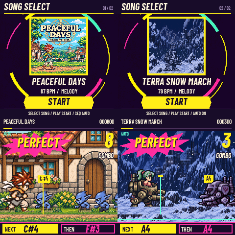

# RetroDash for M-VAVE FM-1

Native pixel-art rhythm-game firmware: play the melody on the FM-1 keys while the other voices accompany you. Built on VaveHero, Dinghy, Felucca and SLOOP.

**0.2.0-beta — two embedded songs, selectable on the FM-1.** Keep *Peaceful Days* (Chrono Trigger Pre-Release SPC, 151 seconds) and add *Terra Snow March* (Final Fantasy VI Opening Theme part 3 SPC, 115 seconds). Turn SELECT on the song screen to switch covers, charts, audio and scenes. The dual-song release is host-tested and build-verified; it has **not been flashed or tested on hardware yet**. Earlier Peaceful Days hardware evidence is documented separately. SMK-37 builds are not validated or released.



Host-rendered capture using the same firmware renderer and song assets; hardware measurements are documented separately.

## Play

- SELECT selects menu items; PLAY confirms. From the title, enter PLAY, turn SELECT to choose either song, then press PLAY on its card.
- Play only the melody. Each pitch always maps to the same physical key; accompaniment plays automatically.
- **KNOB1 adjusts visual/enemy scroll speed, 50–200%, in 10% steps.** This changes approach time and saves the setting; music tempo and judgment timing stay independent.
- The minimum merge division is **1/8 note**. Peaceful Days has **200 manual targets / 2 automatic fills**; FF6 has **78 / 7**; original music events remain intact.
- NEXT is bright and steady. THEN is dim and pulses on the beat. Automatic accompaniment/fills do not create key hints. AUTO and pause turn the hint lights off.
- PLAY pauses; HOME returns to songs. The pause menu offers resume/retry/songs. SEQ on the song screen toggles AUTO. Normal startup defaults to manual play.
- Settings: MUSIC output volume, SPEED music playback rate (50–100%), OFFSET calibration, BACKING accompaniment level (default 30%). KNOB1 is separate from SPEED.

All game pages use a shared UI; song projects supply the protagonist, enemies, background layers, animation and cover. The battle uses native-size sprites/fonts and three scrolling layers, with large judgments and combo feedback.

## Audio and song projects

`projects/peaceful-days-spc/` contains the original SPC, BRR samples, initial audio RAM/registers, timestamped S-DSP events, melody chart, art, scene and credits. The SPC700 driver runs offline; firmware runs the integer **snes_spc fast S-DSP** backend, including original BRR/envelopes/pitch changes/echo, then converts 32 kHz to the platform's 44.1 kHz output.

The fast DSP is not cycle-exact. The accurate offline replay is PCM-identical to full SPC emulation after its four-frame interface delay; the fast version's four checked passages correlated at 0.997–0.998 after alignment. Native device PCM fingerprints matched the same fast backend at all 21 captured checkpoints.

This beta embeds both SPC projects at build time and provides a two-song selector. Each retains its own artwork, chart, audio, duration and score identity. Lossless image/UI/event compression and DSP-only RAM snapshots fit both inside the existing application slot; the storage layout, settings format and original song hash are unchanged. There is no USB song-pack import. A visual `.cqp` alone is not a complete SPC audio package.

An additional [FF6 Terra snow-march song project](projects/ff6-terra-snow/README.md) contains a 115-second SPC, mounted Terra, alternating imperial walkers/infantry, and animated snowfall. It is included alongside Peaceful Days in the default dual-song firmware. Hardware testing of the new release is pending.

See the [song-project creation guide / 歌曲工程创建指南](docs/creating-song-projects.md) for MIDI projects, SPC limitations, art/animation structure and build commands.

## Build and test

Prepare the JieLi pi32v2 toolchain and AC79 SDK as described in [the platform build guide](docs/DINGHY_README.md). Native cross-compilation runs on Linux x86-64; the existing Docker route is also retained.

```sh
python3 -m pip install mido Pillow
# Rebuild both projects (no arguments selects these two):
python3 tools/pack_ui.py
python3 tools/gen_spc_firmware.py projects/peaceful-days-spc projects/ff6-terra-snow
# build.sh defaults to SPC + fast DSP + compact UI:
JIELI_TOOLCHAIN=/path/to/toolchain AC79_SDK=/path/to/sdk ./build.sh --release 0.2.0-beta
```

`build/retrodash-0.2.0-beta.fwsc` includes the update loader. Install over direct USB:

```sh
python3 -m pip install python-rtmidi
python3 tools/fm1_install.py build/retrodash-0.2.0-beta.fwsc --port Felucca --yes
python3 tools/fm1_install.py --info --port Felucca
```

The USB port retains the platform name **Felucca**. RetroDash's independent release identity is **FM-1_91720102**; older private development builds used VaveHero's FM-1_950 identity. Identify an exact build by the release SHA-256, not the identity alone. Hold OCT− while powering on for the inherited USB rescue loader.

Focused host checks (Linux, C/C++ compiler):

```sh
sh tests/run_retrodash.sh
```

31 Python checks and seven native checks cover byte-identical image/UI decoding, renderer comparisons, parallax, manual audio triggers/fills, lights, pause/restart, both full songs, switching back, independent score identities, malformed compressed input, and KNOB1 timing independence. Hardware test tools are optional; `numpy`/`sounddevice` are needed only for USB recordings.

## Hardware evidence and limitations

**The following measurements are from the previous single-song build, not 0.2.0.** See [hardware validation](docs/hardware-validation.md) and [the SPC research notes](docs/spc-audio.md). The 200-target test used real USB MIDI input with AUTO disabled: 200 PERFECT, no misses. It does not claim to mechanically press the physical keys. The tested display is approximately 40–60 FPS (median 49 in that full-song run), not a stable 60 FPS.

The display-freeze fix covers the hardware TIMER4 rollover at approximately 179 seconds. A 210-second device run captured the rollover and continued drawing afterward; ordinary host mode had hidden the bug by using a different clock. Audio callback timings now subtract raw ticks before converting to microseconds.

The USB recording path reported some ring-buffer underflows while recording; the audio render callback itself had no deadline misses. USB capture quality and analog speaker/output quality are distinct checks. Stock-V15 migration/reversion and SMK-37 hardware are not validated by this release.

## Credits and licences

Firmware: **GPL-3.0-only**. Preserve upstream copyright notices; see [LICENSING.md](LICENSING.md). VaveHero by Joakim/joakimskurk; Dinghy by zvenson; Felucca by Leo Kuroshita/Hügelton Instruments; SLOOP by isod89. The S-DSP emulator is Shay Green's **snes_spc**, LGPL-2.1-or-later; its source and licence are included. Fonts retain their OFL licences.

Chrono Trigger and Final Fantasy VI characters, music, the supplied SPC/MIDI and derived game-media assets are third-party demo material and are **not relicensed by the firmware GPL**. Their respective rights remain with their owners. RetroDash is an unofficial fan project, unaffiliated with Square Enix, Nintendo or M-VAVE.
