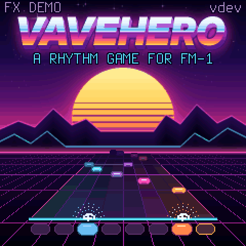
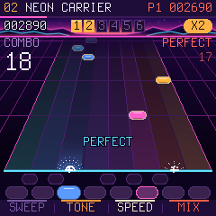
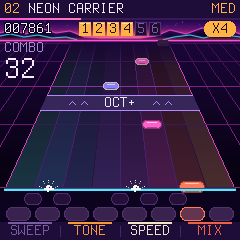
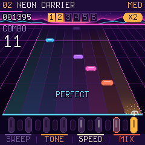
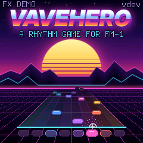
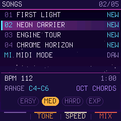
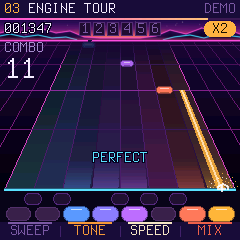
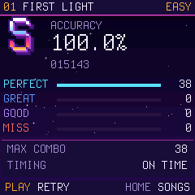
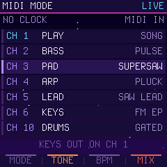
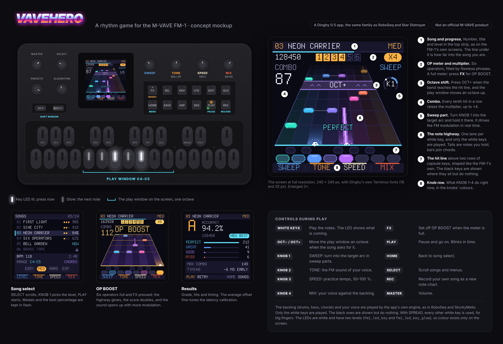

<p align="center"></p>

# VaveHero for M-VAVE FM-1

A rhythm game in the Guitar Hero genre for the FM-1. The notes slide down a note highway, you play them on the
white keys, and the LEDs in the keys show what is coming. Two players, each with their own FM-1, can play against
each other. Built on [Dinghy](https://github.com/zvenson/dinghy) 0.5 by zvenson, in the same family as [RoboSeq](https://github.com/joakimskurk/fm1roboseq),
[Star Distroyer](https://github.com/joakimskurk/fm1stardistroyer) and [SkurkyMello](https://github.com/joakimskurk/fm1mello).

> **Status: browser reference 0.1 and firmware 0.1 in progress, both playable.** The firmware has the game, all four
> songs, the audio engine and MIDI MODE LIVE. It is tested on the host and measured in fm1-emu, but not yet tried on a
> real FM-1: the [page](https://joakimskurk.github.io/fm1vavehero/) asks you to tick that you know before it installs.
> **Testers wanted:** if you have an FM-1 and know how to get it back (hold OCT− while switching on: the USB rescue;
> M-UPGRADE for the official firmware), try it and tell us how it went in an
> [issue](https://github.com/joakimskurk/fm1vavehero/issues). The plan is in [ROADMAP.md](ROADMAP.md).
>
> **This is an early version.** More songs will come, and song submissions are very welcome: see
> [Make your own songs](#make-your-own-songs).

<p align="center"></p>

## Try it

Open [`reference/vavehero.html`](reference/vavehero.html) in a browser and press Enter. The white keys C4–C5 are
on `A S D F G H J K`, OCT− and OCT+ on `Z` and `X`, and FX (OP BOOST) on the space bar. `Q` (GLO) turns on
SPREAD, which puts the lanes on every other white key for big fingers. You can also use a
MIDI keyboard (Chrome and Edge), or click and touch the panel. More in [reference/README.md](reference/README.md).

## Make your own songs

A song is an ordinary MIDI file from a DAW. Each instrument has its own channel (2 BASS, 3 PAD, 4 ARP, 5 LEAD, 6 KEYS,
10 drums), and the play track is on channel 1. The audio engine plays it all in synthwave style, and each
instrument has several patches you select with keyswitch notes (notes 0–11) on the channel. The GRIT setting and the
dirty patches (DIRT BASS, FUZZ LEAD, DIRT drums and more) give the dirty French sound. Load the file into the
reference, and you get a report and can play it right away. Connect the DAW with WebMIDI, and you hear the song
through the audio engine while you make it. It is all in [docs/songs.md](docs/songs.md), and the templates are in [songs/](songs/).

**Send it in.** Submissions are very welcome: VaveHero has four songs for now, and more will come. Open an
[issue](https://github.com/joakimskurk/fm1vavehero/issues) with the MIDI file attached, or a pull request that adds it
to `songs/`. Say who made it and that it may be shared under the project's licence (GPL-3.0). Covers of other people's
songs cannot be taken; songs of your own can.

**MIDI MODE** (at the bottom of the song list) connects the DAW straight to the FM-1 over USB-C. LIVE turns the FM-1
into a sound module with a screen for the channels, and the keys are sent out to the DAW for recording. PREVIEW delays
everything by one bar, so the play track falls down the highway as in the game and you can try to play it while you
write it.

## Two players, two FM-1s

The two-player protocol is built in from the start ([docs/link.md](docs/link.md)). It consists of MIDI messages on
channel 16 and clock, the only messages a Dinghy app receives. In the reference it works between two windows and
against a bot. The goal is one USB-C cable between two FM-1s, but that requires one of the FM-1s to be able to act as
USB host. That will be settled in a separate feasibility study in phase 4. Through a computer it works regardless.

<p align="center">
  
  
  
  
</p>

## Firmware

The firmware is a Dinghy 0.5 app (`firmware/src/vavehero.c`; [PLATFORM.md](PLATFORM.md) says what has been changed
from Dinghy). It plays like the reference: same rules, same note chart, same screens and same sound.

<p align="center">
  
  
  
  
  
</p>

| | |
|---|---|
| The title screen | An 80s video game cover: the chrome logo, a striped sun and mountains. The game's own highway is the road into the sunset and plays itself on a neon floor. PLAY goes to the songs. FX starts the DEMO, ENGINE TOUR from bar 41 on autoplay. |
| The songs | SELECT chooses the song. Each song has its own level, EASY, MED, HARD or EXP, as on the arcade machines, counted from its notes over time ([D12, D13](docs/DECISIONS.md)). KNOB 2 chooses the voice (TONE), KNOB 3 the speed and KNOB 4 MIX. ALGORITHM controls GRIT (on every screen but a song's). GLO turns SPREAD on and off, and SEQ turns AUTO on and off (the song plays itself, and the result is not saved). PLAY starts. |
| During a song | The eight keys in the layout play the lanes. OCT− and OCT+ follow the octave shifts, FX triggers OP BOOST, PLAY pauses and HOME quits. |
| The results | The best result per song is saved in flash. PLAY plays again, HOME goes to the songs. |
| MIDI MODE | LIVE: the FM-1 is a sound module for the song, one part per channel, with keyswitch notes. The keys are sent out on channel 1. PREVIEW comes later. |

The key LEDs show what is coming: lit when the note is at the line, glowing when it arrives within two beats.

**Measured in fm1-emu:** the heaviest spot in the songs, bars 41–44 of ENGINE TOUR, played by the DEMO with the game
running, uses 30.8 % of the chip for audio, and 33.6 % with the platform's interrupts. The heaviest audio block uses
42 % of its time budget. With the screen's SPI timed as on an FM-1 (12 MHz), the play holds 60 frames per second,
because only what changed is sent (D11, measured with `tools/emu_timing.py`). All 25 patches and 4 drum kits are within 1.5 dB of the reference, and the full songs within
0.8 dB. More in [docs/fm1-budget.md](docs/fm1-budget.md).

```sh
make test          # VaveHero's host tests: the sound against the reference, the rules, the screens; no FM-1 needed
make fw            # build/vavehero.fwsc: requires JieLi's toolchain and the AC79 SDK (docs/DINGHY_README.md)
```

GitHub Actions builds the `.fwsc` package on every push, runs the tests and measures the DEMO in fm1-emu
(`.github/workflows/build.yml`, via zvenson/fm1-build). The package is named `FM-1_95N`, where N is the minor version,
and 0 is a developer build.

**Try it without an FM-1:** download `packages` from a build under *Actions* on GitHub, extract `vavehero.fwsc` and
open it in [fm1-emu](https://joakimeriksson.github.io/fm1-emu/) in the browser. The page can open a local package. The
keys and buttons are on the computer's keyboard and mouse, and a MIDI keyboard works in Chrome and Edge.

## Contents

| | |
|---|---|
| [docs/concept.md](docs/concept.md) | The idea sketch: game mechanics, levels, modes and technical notes |
| [docs/songs.md](docs/songs.md) | Make your own songs: the channels, the rules and the export |
| [docs/link.md](docs/link.md) | LINK: the layers from browser to USB-C, and the protocol |
| [docs/fm1-budget.md](docs/fm1-budget.md) | Does it all fit on the FM-1? Memory, CPU, graphics, songs and score |
| [docs/DECISIONS.md](docs/DECISIONS.md) | The decisions D1–D11 |
| [songs/](songs/) | The four built-in songs as MIDI files, which are also templates. ENGINE TOUR shows all 29 sounds, CHROME HORIZON is a full song in D minor (`python3 tools/songs.py` makes them). |
| [ROADMAP.md](ROADMAP.md) | The phases, with checkboxes |
| [reference/](reference/) | The browser reference, the ground truth before the port |
| [mockup/](mockup/) | The first mockup: the device and four screens (`node mockup/render.cjs` makes the PNGs) |
| [web/](web/) | The site: a page with the installer in the browser (Web MIDI, Chrome or Edge) and the game in the browser. CI publishes it to GitHub Pages from the default branch (`web/make_site.py`) |
| [tests/reference.cjs](tests/reference.cjs) | Plays the reference in Chromium and checks score, LINK and the bot |
| [firmware/](firmware/) | The firmware: Dinghy 0.5 and the app `src/vavehero.c` |
| [PLATFORM.md](PLATFORM.md) | Which Dinghy, and what has been changed from it |
| [docs/API.md](docs/API.md), [docs/RULES.md](docs/RULES.md) | Dinghy's API and the chip's rules (from Dinghy) |

<p align="center"></p>

## Credits

VaveHero stands on other people's work:

- [Dinghy](https://github.com/zvenson/dinghy) by **zvenson**: the firmware platform VaveHero is built on (its USB,
  MIDI, screen, keys, storage, update loader and boot guard), its docs and host tests, and
  [fm1-build](https://github.com/zvenson/fm1-build), which builds the package in CI.
- [Felucca](https://github.com/hugelton/Felucca) by **Leo Kuroshita** (@kurogedelic, Hügelton Instruments) and
  [SLOOP](https://github.com/isod89/sloop-fm1) by **isod89**: the platform under Dinghy, and the browser installer the
  page uses.
- [fm1-emu](https://github.com/joakimeriksson/fm1-emu) by **joakimeriksson**: the FM-1 emulator VaveHero is tested and
  measured in.
- [MvaveFM1-Designer](https://github.com/Quixotic7/MvaveFM1-Designer) by **Quixotic7**: the panel's measurements.
- The fonts: Terminus (SIL OFL 1.1) on the screen, Inter by Rasmus Andersson (SIL OFL 1.1) in the logo.

Who made which file is in [LICENSING.md](LICENSING.md), and what VaveHero changed in Dinghy is in
[PLATFORM.md](PLATFORM.md).

The panel geometry is taken from the measurements in [Quixotic7/MvaveFM1-Designer](https://github.com/Quixotic7/MvaveFM1-Designer).
The songs are original compositions. The firmware is free software under GPL-3.0 ([LICENSE](LICENSE); who made
what is in [LICENSING.md](LICENSING.md)). The Terminus font is licensed under SIL OFL 1.1
([assets/fonts/Terminus-LICENSE.txt](assets/fonts/Terminus-LICENSE.txt)). This is a fan project and not an
official M-VAVE product.
