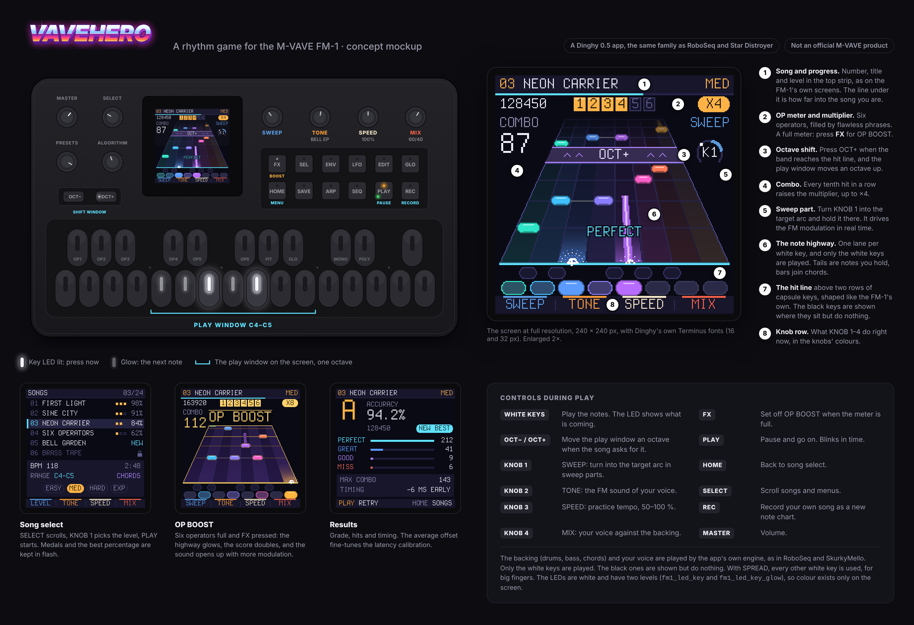

# VaveHero: a rhythm game for the M-VAVE FM-1 (concept sketch)

*Inspired by the genre Guitar Hero established, but with its own graphics, its own songs and game mechanics built around the FM-1's own
panel. The working title was KEYFALL. The name VaveHero was decided in D9.*

## Core idea

Notes slide down a note highway towards a hit line, and you play them on the FM-1's 27 keys in time with the music.
The FM-1 is controller, sound source and game console at once. It has two things a guitar controller does not have:

- **An LED in every key.** The game can light up the key you should press now, and let the next ones glow faintly.
  The screen shows what is coming, and the keys show where to press.
- **A synth.** The sound can respond to how you play. If you play flawlessly, the patch opens up. If you miss, the
  note goes dull and out of tune.

## What the FM-1 and Dinghy give us

| | |
|---|---|
| Keys | 27 silicone keys, F3–G5 (16 white, 11 black), in two rows of capsule-shaped keys. Scanned at 10 kHz and debounced. `fm1_input_note_edges()` also catches presses that are shorter than one pass of the main loop. |
| LED | One white LED per key and per button, at two levels: `fm1_led_key` (lit) and `fm1_led_key_glow` (glow, ~1/24). REC is red, PLAY is orange and also has a green LED. |
| Screen | 240 × 240 px, 16-bit colour. Two fonts: `FONT_S` (Terminus 16 px) and `FONT_L` (32 px, capitals only). Drawn in canvases that are sent with DMA (a strip of 240 × 64 takes about 3 ms). |
| Knobs | KNOB 1–4 below the screen, SELECT, PRESETS, ALGORITHM and MASTER (volume). |
| Buttons | FX, SEL, ENV, LFO, EDIT, GLO, HOME, SAVE, ARP, SEQ, PLAY, REC, and OCT− / OCT+. |
| Audio | The app's own engine in the audio interrupt: 44.1 kHz, 256 frames every 5.8 ms, fixed point only. |
| MIDI | USB-MIDI in and out, TRS MIDI in, and MIDI clock in. |
| Storage | Settings, 8 blobs and 8 slots in flash. |

In M-VAVE's own firmware the first six black keys are **OP1–OP6**. That fits the game's
"six operators" meter well.

## How it is made (the same recipe as the other FM-1 projects)

1. **`reference/vavehero.html`, a playable browser version.** It is the reference for sound, feel and timing, as
   `roboseq.html` and `skurkymello.html` are for their projects. It is played with the computer keyboard, and
   optionally with an FM-1 or another MIDI keyboard over WebMIDI. This is where we find out whether the game is fun: lane width,
   timing windows, levels and note charts.
2. **A Dinghy 0.4 app**, made like RoboSeq and Star Distroyer: `vavehero.c`, `APP_NAME "VAVEHERO"`, its own
   `FELUCCA_ID`, tested on the host and in fm1-emu, and delivered as `.fwsc` with commit and SHA-256. It can also get an
   `fmhub.json` card for Firmware Hub.
3. **Reuse from our own repos:**
   - **RoboSeq:** the BAND engine (drums, bass, backing), battle mode with a split keyboard, the mini keyboard at the bottom
     of the screen, the playability rules P1–P4, and the sound test against renders of the HTML reference.
   - **SkurkyMello:** chord voicings, drum grids and bass.
   - **Star Distroyer:** the FM voice.
   - **FM1Tracker:** the data model for patterns can become the basis for note charts.

## The game

### The note highway

- **Only the white keys are played** ([decision D1](DECISIONS.md)). One play window is one octave: eight lanes,
  one per white key from C to C. The black keys are shown on the screen where they sit, but have no function. They
  give no score and no penalty.
- **SPREAD for big fingers** ([D2](DECISIONS.md)): the lanes are placed on every other white key (F3 A3 C4 E4 G4 B4 D5 F5),
  with one unused key between each. The music is the same, just with more room between the fingers. SPREAD is turned on and off
  with GLO.
- **White keys do not mean only C major.** The game can transpose the sound, so the white keys follow the song's
  key. A song in E-flat major is played with C major fingering and heard in E-flat. You get the modes by choosing the root: A minor,
  D Dorian, E Phrygian and so on.
- At the bottom of the screen is the key strip in two rows, shaped like the FM-1's capsule keys: the black ones on top, the white ones
  below. With SPREAD it shows the used keys with an LED strip, and a dark, unused key between each.
- **Octave shift:** a purple OCT+ or OCT− band comes down the highway. Press the button in time, and the window moves one
  octave. This way a song gets a wider range without the lanes getting too narrow.
- **Tails** are notes you hold. **Chords** are notes on the same line, joined by a thin line.

### Levels: more keys, not just more notes

| Level | Keys | Content |
|---|---|---|
| EASY | 5 white (C–G, one hand position) | Single notes, no shifts |
| MED | The whole octave C–C, 8 white | Two-note chords, tails, the occasional OCT shift |
| HARD | The whole octave, 8 white | Fast runs, triads, frequent shifts, sweep sections |
| EXP | All 16 white keys, F3–G5, on a flat highway (14.5 px per lane) | Everything |

A song has one of these levels, fixed, as on the arcade machines ([D12](DECISIONS.md)): the import counts it from the notes over time ([D13](DECISIONS.md)), and its maker can set it with a marker in the MIDI file (`LEVEL EASY` .. `LEVEL EXP`). Nothing is thinned out by a program. (The first sketch made the levels from one file by thinning; D12 replaced that.)

### Score

- PERFECT ±35 ms, GREAT ±70 ms, GOOD ±110 ms. Everything outside is MISS. The windows are tuned in the HTML reference.
- Every tenth hit in a row raises the multiplier, up to ×4.
- **OP BOOST** is the game's "star power". Six segments, one per operator. Notes in an OP phrase have a bright edge,
  and a flawless phrase lights two operators. When the meter is full, the FX LED blinks. Press **FX**, and you get double
  score for 4 bars. The highway glows yellow and the patch opens up with a higher modulation index.
- **Sweep sections** are a separate mechanic (the guitar game's whammy bar does not exist here). A target arc appears, and you turn
  **KNOB 1** into it and hold it there. The knob controls the FM modulation in real time, so you hear that you are on target.

### The sound: synthwave

The audio engine is made for synthwave and retrowave ([D4](DECISIONS.md)): detuned saw pads with chorus and a big hall,
pulsing eighth-note bass, arpeggio with tempo delay, a saw lead, FM piano, snare and clap with gated reverb,
and syndrum toms. GRIT makes the sound dirtier, with pumping from the kick, saturation and crunch ([D7](DECISIONS.md)). Each instrument has several patches, which the song switches between with keyswitch notes ([D6](DECISIONS.md)).
The player follows the song's choice (TONE SONG) or picks their own voice with KNOB 2: SYN LEAD, BELL EP, BRASS or GLASS.

### The sound responds

- A long combo makes the sound gradually brighter (the filter or the modulator opens up).
- A miss briefly muffles the note and puts it slightly out of tune, without the backing stopping.
- This is the main difference from a guitar controller: on the FM-1, the instrument and the game are the same thing.

## Modes

- **Setlist:** songs that unlock over time, with medals and best percentage saved in flash.
- **Practice:** SPEED (KNOB 3) from 50 to 100 %, looping a section, and "wait for the right key" (the game waits until you
  hit it). You can also practice one hand at a time.
- **Listen and repeat:** the game plays a phrase while the LEDs show it, and then you play it back. It suits
  the small screen well and works as a tutorial.
- **Two players, two FM-1s (LINK):** each player has their own FM-1, and the units are connected. In VS both play
  the same song at the same time and see each other's score. Later come alternating phrases and band (co-op). The protocol is
  built in from the start, and the goal is one USB-C cable between the units. See [link.md](link.md), also for why a direct USB-C
  connection requires USB host mode.
- **Duel on one FM-1:** a simpler variant where each player gets their own end of the keyboard, as in RoboSeq's
  battle.
- **Record (REC):** record a melody on the FM-1, and it is saved as a note chart a friend can play. That meets
  RoboSeq's rule that there should always be something to play.
- **Calibration:** press in time with a click, and a latency offset is saved. The results screen shows the average, which
  fine-tunes the calibration over time.

## The screens

See `mockup/screens/` (240 × 240 px, exactly as they would be drawn): **SONGS**, **play**, **OP BOOST** and
**results**. Shared rules:

- A top bar with number, title and level, and a bottom bar that shows what KNOB 1–4 do, in the knobs' colours.
- Only `FONT_S` and `FONT_L`. Large numbers (combo, percentage, grade) use `FONT_L`.
- Pixel graphics without anti-aliasing. Glow is made with a one-pixel darker edge, not blur.

## Technical notes

- **Precise timing:** read the key edges in the `LCD_IDLE` hook while DMA sends the screen, and timestamp them with
  `fm1_ticks()`. Otherwise a press can sit for a whole drawing pass (10–15 ms) before it is registered.
- **Drawing:** the highway is redrawn every frame, in strips. The perspective is just rows of different widths, so it costs
  about the same as a flat highway. The target is at least 30 fps for the highway. The top bar and the knob row are drawn only when they
  change.
- **Audio:** the player's voice and the backing run in the same audio interrupt, with fixed point and limited work per block, as in
  the other projects. The game logic stays in the main loop and talks to the audio through `volatile` variables.
- **Songs are MIDI files** ([D3](DECISIONS.md), [songs.md](songs.md)). Each instrument has its own MIDI channel, and
  the play track is on channel 1. They are made in a DAW, tried in the reference, and turned into a compact note chart for
  the firmware, for example 4 bytes per note (time, key, length, flags). 1000 notes take 4 KB, so 20–30 songs can
  fit in flash. Your own recordings go in slots.
- **The audio engine on the FM-1:** the synthwave sound has to be made in fixed point. That means saws with PolyBLEP, simple filters,
  chorus, gated reverb and hall, and it has to be measured in fm1-emu. Star Distroyer already has oscillators, delay and
  reverb in fixed point on the FM-1.
- **Songs:** use our own compositions, our own arrangements of copyright-free music, or songs from
  the community. No commercial songs.

## Open questions

- How large is the actual latency from key via sound to ear on real hardware? We can only measure that once there
  is an FM-1 to test on. Until then, fm1-emu and the host build are used.
- Is it possible to get velocity from the silicone keys? If so, accent notes could become a note type of their own.
- Perspective highway or flat highway on EXP? That is decided in the HTML reference.

## Plan

The plan with phases and checkboxes is in [ROADMAP.md](../ROADMAP.md):

0. Idea and mockup (done)
1. Browser reference 0.1 (done): playable, with LINK in two windows and against a bot
2. Reference 0.2: game feel, sweep, practice, more songs, note chart format
3. Dinghy port
4. **LINK on hardware: two FM-1s connected with USB-C.** The pre-study on USB host mode can start now.
5. Release
