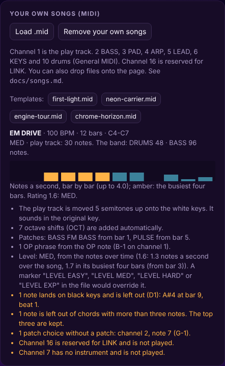
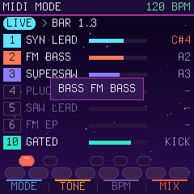
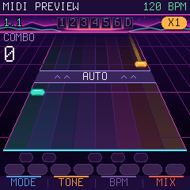

# Make your own songs

A VaveHero song is an ordinary MIDI file (`.mid`), made in any DAW. Each instrument has its own MIDI channel, and the
play track, the notes the player is to play, sits on a channel of its own. The audio engine plays the rest in
synthwave style ([D3](DECISIONS.md), [D4](DECISIONS.md)).

The four built-in songs are made exactly this way and work as templates (they can also be downloaded from the
reference):

| File | Song | What it shows |
|---|---|---|
| [`first-light.mid`](../songs/first-light.mid) | FIRST LIGHT, 96 BPM, EASY | The simple one: five white keys, BELL EP, SUB bass and STRINGS |
| [`neon-carrier.mid`](../songs/neon-carrier.mid) | NEON CARRIER, 112 BPM, MED | Octave shifts, chords and patch changes between the sections |
| [`engine-tour.mid`](../songs/engine-tour.mid) | ENGINE TOUR, 120 BPM, HARD | **A tour of the audio engine.** The drums alone first, then bass, pad, arpeggio, lead and keys come in one by one. Each instrument goes through all four of its patches, two bars each, with the dirty one last. The drum kits and the player's voice change along the way, and at the end everything plays together on the dirty sounds. All 29 sounds are heard. |
| [`chrome-horizon.mid`](../songs/chrome-horizon.mid) | CHROME HORIZON, 104 BPM, MED | **A full synthwave song in D minor:** intro, verse, pre-chorus, dirty choruses with DIRT BASS, DIRT drums and FUZZ LEAD, a breakdown, and a final chorus an octave up with FUZZ as the player's voice. The play track is written in D minor, and the import moves it 5 semitones down to white keys. |

Each patch in ENGINE TOUR (two bars each, the clean ones first and the dirty one last):

| Bars | What comes in |
|---|---|
| 1–4 | Drums alone (GATED) |
| 5–12 | BASS: PULSE, FM BASS, SUB, DIRT BASS. The player's voice is SYN LEAD. |
| 13–20 | PAD: SUPERSAW, STRINGS, GLASS PAD, GRIT PAD. Drums TIGHT, voice BELL EP. |
| 21–28 | ARP: PLUCK, BELL, SQUARE, CRUSH. Voice BRASS. Drums BOOM from bar 25. |
| 29–36 | LEAD: SAW, SQUARE, BRASS and FUZZ LEAD. Voice GLASS, an octave up in bars 33–36. |
| 37–44 | KEYS: FM EP, TINE, ORGAN, GRIT EP. Drums DIRT, voice FUZZ. |
| 45–49 | Everything together, on the dirty patches |

## The channels

| Channel | Part | Sound in the reference |
|---|---|---|
| **1** | **PLAY**, the play track | The notes that fall down the highway. The player makes the sound themselves (TONE: SYN LEAD, BELL EP, BRASS, GLASS). |
| 2 | BASS | Two detuned sawtooth oscillators and a sub, resonant low-pass. Made for pulsing eighth notes. |
| 3 | PAD | Four detuned sawtooth oscillators, slow filter sweep, chorus and a large hall |
| 4 | ARP | Square and sawtooth, short and bright, with tempo delay |
| 5 | LEAD | Sawtooth lead with vibrato and delay (counter-melody, intro) |
| 6 | KEYS | FM piano |
| 10 | DRUMS | General MIDI drums (below), three drum kits |
| 16 | *LINK* | Reserved for the two-player protocol. Notes here are not played. |

Channels 7–9 and 11–15 have no sound yet. The import tells you if they are used.

### Patches: several sounds per instrument ([D6](DECISIONS.md))

Each instrument has several patches. You choose the patch with a **keyswitch note** on the instrument's own channel:
notes 0–11, below any musical register, which are never heard. Note 0 gives patch 1, note 1 patch 2, and so on. The
patch applies from the keyswitch note until the next one. Without a keyswitch note, patch 1 is used. A keyswitch note
can sit at the same time as the first note it applies to.

| Channel | Note 0 (C-1) | Note 1 (C#-1) | Note 2 (D-1) | Note 3 (D#-1) | Note 4 (E-1) |
|---|---|---|---|---|---|
| 1 PLAY | SYN LEAD | BELL EP | BRASS | GLASS | **FUZZ** |
| 2 BASS | PULSE (pulsing sawtooth) | FM BASS | SUB | **DIRT BASS** |  |
| 3 PAD | SUPERSAW | STRINGS | GLASS PAD (FM) | **GRIT PAD** |  |
| 4 ARP | PLUCK | BELL (FM) | SQUARE | **CRUSH** |  |
| 5 LEAD | SAW LEAD | SQUARE LEAD | BRASS LEAD | **FUZZ LEAD** |  |
| 6 KEYS | FM EP | TINE | ORGAN | **GRIT EP** |  |
| 10 DRUMS | GATED (80s gated reverb) | TIGHT (dry) | BOOM (long kick, long toms) | **DIRT** (distorted and crushed) |  |

The ones in bold are the dirty patches ([D7](DECISIONS.md)). They have distortion after the filter, and some have a
crushed copy (bitcrush) mixed in. Together with the GRIT setting they give the French, dirty sound (Kavinsky, Justice).

- Many DAWs call note 0 **C-1**. Some, Cubase among them, call it **C-2**. It is the same note.
- On channel 1 the keyswitch note chooses the player's voice through the song, when TONE (KNOB 2) is set to **SONG**,
  which is the default. The player can always choose a fixed voice with KNOB 2 instead.
- On channel 1, note 11 (B-1) is reserved for OP phrases (see below), so the voices are on notes 0–4.
- A keyswitch note with no patch, for example note 7 on BASS, does nothing and is shown in the import report.
- Everything is notes. Program Change and CC are not used, so everything can be drawn straight into the piano roll.
- It works the same live: send keyswitch notes from the DAW, and the sound changes at once (in PREVIEW in time with the
  rest), and the LIVE screen shows the patch on each channel.

NEON CARRIER shows how: the bass goes to FM BASS in the chorus, the pad to STRINGS and the player's voice to BELL EP in
the high verse.

### Drums on channel 10

| Note | Sound |
|---|---|
| 35, 36 | Kick |
| 38, 40 | Snare with gated reverb |
| 39 | Clap (gated) |
| 37 | Rimshot |
| 42, 44 | Closed hi-hat |
| 46 | Open hi-hat |
| 49, 57 | Crash |
| 41, 43, 45, 47, 48, 50 | Syndrum toms, from low to high |

## The play track (channel 1)

- **White keys only** ([D1](DECISIONS.md)). You can write in any key. The import finds the transposition that puts the
  most notes on the white keys, and the song still sounds in its original key. A song in E minor is then played with
  A minor fingering. Notes that still end up on black keys are removed and shown in the report.
- **Octaves sort themselves out.** The highway shows one octave (C to C). When the melody goes outside it, the import
  inserts an octave shift (OCT+ or OCT−) between two notes. Ideally, give the melody at least half a beat of rest
  before big leaps.
- **Chords:** at most three notes at once, within one octave. Notes beyond that are removed.
- **Hold notes:** a note of 1.5 beats or more becomes a hold note with a tail. Shorter notes are ordinary presses.
- **OP phrases:** put note 11 (B-1) on channel 1 and hold it for as long as the phrase lasts. In the piano roll it is a
  line under the phrase. Flawless phrases fill the OP meter. Without OP notes the import makes phrases itself (two bars
  out of every four).
- **The level** is the song's own, one of EASY, MED, HARD and EXP ([D12](DECISIONS.md)), as on the arcade machines:
  the player chooses the song, not the level. The import counts it from the notes over time ([D13](DECISIONS.md)):
  notes a second at the song's tempo, every chord note counted, over the whole song and over its busiest four bars.
  The rating is 0.3 × the whole + 0.7 × the busiest, to one decimal: under 1.6 EASY, under 2.7 MED, under 3.8 HARD, from 3.8 EXP.
  The report shows the rating and the notes a second bar by bar. The chart is the play track as you wrote it, so
  write an EASY song to be easy.
- **To set the level yourself,** put a marker (or a text event) in the file that says `LEVEL EASY`, `LEVEL MED`,
  `LEVEL HARD` or `LEVEL EXP`, anywhere in any track. It overrides the count, and the report says what the notes alone
  would have given.

  | Level | Rules | Write it with |
  |---|---|---|
  | EASY | The right note in any octave counts. The octave shifts happen by themselves. | Single notes on the beat, few leaps |
  | MED | The right note in the right octave. The player follows the shifts with OCT− and OCT+. | Chords of two, hold notes, the odd shift |
  | HARD | As MED | Faster runs, chords of three, more shifts |
  | EXP | As MED | Everything |

## Tempo and time signature

- One tempo per song. If the file has tempo changes, the first one is used.
- VaveHero counts in 4/4. Other time signatures are imported, but the highway's bar lines follow 4/4.
- The song ends at the end of the bar in which the last note ends.

## Export

Export as a **Standard MIDI File**, format 0 or 1. Both work, and the time must be in bars and beats (PPQ, not SMPTE).
The name of the first track becomes the song's title, otherwise the file name. The title is shown in capital letters
and with at most 15 characters.

## Try the song in the reference

1. Open `reference/vavehero.html`.
2. Press **Load .mid** under *Your own songs*, or drop the file on the page.
3. The report shows tempo, length, the level, the notes, transposition, octave shifts, OP phrases and everything that has
   been removed or ignored.
4. The song ends up at the bottom of the song list and is remembered in the browser. **Remove your own songs** empties
   the list.

## MIDI MODE: the DAW straight into the FM-1 ([D5](DECISIONS.md))

 

1. Connect the FM-1 to the computer with USB-C. It shows up as a MIDI device.
2. On the FM-1: scroll to **MIDI MODE** at the bottom of the song list and press PLAY.
3. In the DAW: send each track to the FM-1 on its channel (1 the play track, 2 BASS, 3 PAD, 4 ARP, 5 LEAD, 6 KEYS,
   10 drums). Turn on **MIDI clock out** to the FM-1, and it follows the tempo and shows bar and beat.
4. **LIVE** plays everything at once, and shows activity and the last note per channel. Notes on channel 1 light up
   the keys, and a note on a black key turns red.
5. Press PLAY for **PREVIEW**: everything is delayed by one bar, and the play track falls down the highway as it will
   in the game. Play along on the keys to feel whether it is playable. Red marks are notes on black keys, which are
   removed on import.
6. **Record from the FM-1:** the keys are sent out on channel 1. Turn off MIDI echo (thru) to the FM-1 on the track you
   record on, otherwise the notes are played twice.
7. Without a clock: set the tempo with KNOB 3 (BPM). HOME goes back to the song list.

Good to know:

- Start the DAW from bar 1. The FM-1 does not get the song position (Song Position Pointer), so the bar counter starts
  where the DAW starts.
- Turn off the DAW's own sound in PREVIEW, otherwise you hear everything twice, one bar apart.
- LINK must be off. MIDI MODE and the two-player link both use the MIDI clock.

**In the reference** it is the same: connect the DAW to the browser with WebMIDI (Chrome or Edge, *Connect MIDI*),
choose it as "In", and optionally a port as "Out" for recording. On a Mac this works with the IAC driver, on Windows
with, for example, loopMIDI. Outside MIDI MODE the reference also plays the channels directly, but without the channel
screen and without PREVIEW.

## Two players

In VS, P1 sends the song's identity, a hash of the play track (see [link.md](link.md)). P2 must have the same file
loaded. If not, P2's screen shows `SONG NOT HERE`.

## On the FM-1

In the firmware, a small tool turns the songs into a compact note chart in flash. The channels and rules above are the
same, so a song that works in the reference works on the FM-1. See phase 3 in [ROADMAP.md](../ROADMAP.md).
